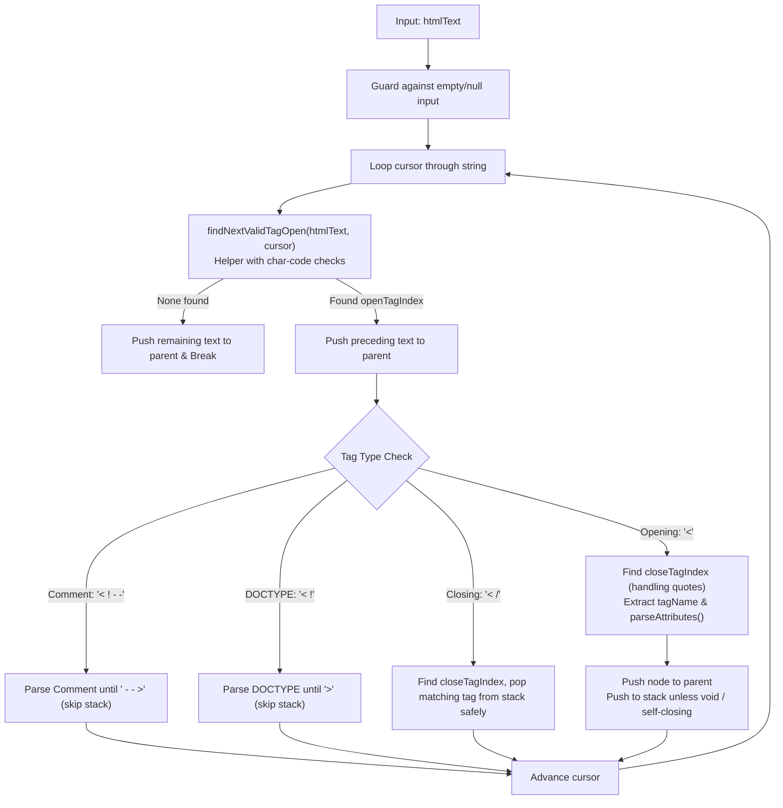

# HTML to JSON Parser Improvement Plan

## Goal Description
Enhance `html2json.js` to strictly adhere to the test task requirements from `README.md`:
1. Prevent any crashes or infinite loops (guarantee robust error and edge-case tolerance).
2. Refactor code structure for clarity: extract character-code validation into a dedicated helper function and rename indexing variables (`openTagIndex`, `closeTagIndex`).
3. Handle special HTML constructs properly (DOCTYPE, comments, self-closing tags with `/>`).
4. Design and implement attribute parsing **without using DOM parsers or regular expressions**, relying purely on character-by-character scanning.

---

## User Review Required

> [!IMPORTANT]
> **Key Decision Question:**
> **Do you want to implement the attribute parser right now in this iteration, or would you prefer we first perform and verify the code structure improvements & safety checks, and then add attributes in the next step?**

> [!NOTE]
> **Attribute Value Representation:**
> For boolean attributes (e.g., `<button disabled></button>`), we can store them as:
> - `true` (e.g. `{ disabled: true }`) — standard AST practice (e.g. Babel/Hast).
> - Empty string `""` (e.g. `{ disabled: "" }`) — HTML specification reflection.
> In this plan, we default to `true` or raw string value.

---

## Proposed Architecture & Improvements



---

## Detailed Step-by-Step Breakdown

### 1. Code Structure & Variable Naming
- **Helper function `isValidTagStart(htmlText, index)`**:
  - Encapsulates the character code checks so the main loop remains readable.
  - Checks if the character following `<` is:
    - `a-z` (`97`–`122`) or `A-Z` (`65`–`90`)
    - `/` (`47`) for closing tags
    - `!` (`33`) for comments (`<!--`) or `<!DOCTYPE>`
- **Variable renames**:
  - `nextBracketIndex` $\rightarrow$ `openTagIndex`
  - `closeBracketIndex` $\rightarrow$ `closeTagIndex`
- **Helper function `findNextTagOpen(htmlText, fromIndex)`**:
  - Finds `<` using `indexOf('<', fromIndex)` and validates with `isValidTagStart`, continuing until a valid tag start is found or returning `-1`.

---

### 2. Safety & Crash Prevention (README: "The code MUST NOT crash")
- **Missing `>` check**:
  - If `closeTagIndex === -1` (unclosed `<tag`), gracefully treat the remainder as a text node or advance the cursor to avoid infinite loops.
- **Stack Underflow Protection**:
  - Prevent popping the `root` node (`stack.length > 1`).
  - Check whether the closing tag matches the current top of the stack. If there is a mismatch (e.g., unexpected `</div>`), safely discard or handle it without breaking the parent pointer.
- **DOCTYPE & Comment Handling**:
  - Comments (`<!-- ... -->`) and DOCTYPEs (`<!DOCTYPE ...>`) should **not** be pushed onto the stack, preventing all subsequent elements from being trapped inside them.

---

### 3. Attribute Parsing (Zero DOM, Zero Regex)
The attribute parser will scan character-by-character using index pointers:

```javascript
/**
 * Pure character-by-character attribute parser.
 * No DOMParser, no regular expressions.
 * @param {string} rawTagInside - String between `<tag` and `>` (e.g. ' id="btn" class="active" disabled ')
 * @returns {Record<string, string | boolean>}
 */
function parseAttributes(rawTagInside) {
  const attributes = {};
  let i = 0;
  const len = rawTagInside.length;

  while (i < len) {
    // 1. Skip whitespace (space, tab, newline, carriage return)
    while (i < len && rawTagInside.charCodeAt(i) <= 32) {
      i++;
    }
    if (i >= len) break;

    // Check for self-closing slash at the end of the tag (e.g. '')
    if (rawTagInside.charCodeAt(i) === 47 /* '/' */) {
      i++;
      continue;
    }

    // 2. Read attribute name
    const nameStart = i;
    while (
      i < len &&
      rawTagInside.charCodeAt(i) > 32 &&
      rawTagInside.charCodeAt(i) !== 61 /* '=' */ &&
      rawTagInside.charCodeAt(i) !== 47 /* '/' */ &&
      rawTagInside.charCodeAt(i) !== 62 /* '>' */
    ) {
      i++;
    }
    const attrName = rawTagInside.substring(nameStart, i);
    if (!attrName) break;

    // 3. Skip whitespace between name and '='
    while (i < len && rawTagInside.charCodeAt(i) <= 32) {
      i++;
    }

    // 4. Check if there is an '=' sign
    if (i < len && rawTagInside.charCodeAt(i) === 61 /* '=' */) {
      i++; // consume '='

      // Skip whitespace after '='
      while (i < len && rawTagInside.charCodeAt(i) <= 32) {
        i++;
      }

      if (i >= len) {
        attributes[attrName] = "";
        break;
      }

      const quoteCode = rawTagInside.charCodeAt(i);
      if (quoteCode === 34 /* '"' */ || quoteCode === 39 /* "'" */) {
        // Quoted value
        i++; // skip opening quote
        const valStart = i;
        while (i < len && rawTagInside.charCodeAt(i) !== quoteCode) {
          i++;
        }
        attributes[attrName] = rawTagInside.substring(valStart, i);
        if (i < len) i++; // skip closing quote
      } else {
        // Unquoted value: read until whitespace or tag delimiter
        const valStart = i;
        while (
          i < len &&
          rawTagInside.charCodeAt(i) > 32 &&
          rawTagInside.charCodeAt(i) !== 47 /* '/' */ &&
          rawTagInside.charCodeAt(i) !== 62 /* '>' */
        ) {
          i++;
        }
        attributes[attrName] = rawTagInside.substring(valStart, i);
      }
    } else {
      // Boolean attribute (e.g. 'disabled', 'required', 'checked')
      attributes[attrName] = true;
    }
  }

  return attributes;
}
```

#### Finding `closeTagIndex` with Quoted Values:
Because attributes can contain `>` (e.g. `<input placeholder="a > b">`), finding the closing `>` must also skip quoted strings:
- Scan forward from `openTagIndex + 1`.
- Track quote states (`'` and `"`).
- Only treat `>` as `closeTagIndex` when **outside** of quotes.

---

## Proposed Changes to Codebase

### [MODIFY] [html2json.js](file:///d:/projects/test_tasks/html-parser/html2json.js)
- Add `isValidTagStart(htmlText, index)` helper function.
- Add `findNextOpenTagIndex(htmlText, fromIndex)` helper function.
- Add `findTagCloseIndex(htmlText, openTagIndex)` helper function that ignores `>` inside quotes.
- Implement `parseAttributes(attrString)` (character-by-character scanner).
- Refactor `html2json(htmlText)`:
  - Rename `nextBracketIndex` $\rightarrow$ `openTagIndex`.
  - Rename `closeBracketIndex` $\rightarrow$ `closeTagIndex`.
  - Add stack underflow guard.
  - Add DOCTYPE and comment handling.
  - Integrate attribute parsing and handle self-closing tags (`SELF_CLOSING_TAGS` and trailing `/`).

---

## Verification Plan

### Automated / Manual Test Cases
1. **Basic Tags & Hierarchy:**
   - Run `Example 1` and `Example 2` in `index.html`.
2. **Robustness & Edge Cases:**
   - Mathematical expressions with `<` (e.g., `<p>Score is 5 < 10 and 12 > 4</p>`).
   - Unclosed tags (e.g., `<div class="test" Hello world`).
   - Unmatched closing tags (e.g., `</div><p>test</p></span>`).
   - Attributes with `>` inside quotes (e.g., `<input value="5 > 3" placeholder=">>">`).
   - Boolean attributes (e.g., `<input type="checkbox" checked disabled>`).
   - Self-closing variations (`<br>`, `<br/>`, ``).
   - Comments (`<!-- normal comment -->`, `<!-- comment with > inside -->`).
   - DOCTYPE (`<!DOCTYPE html>`).
3. **Empty / Invalid Inputs:**
   - `""`, `"   "`, `null`, `undefined`.
