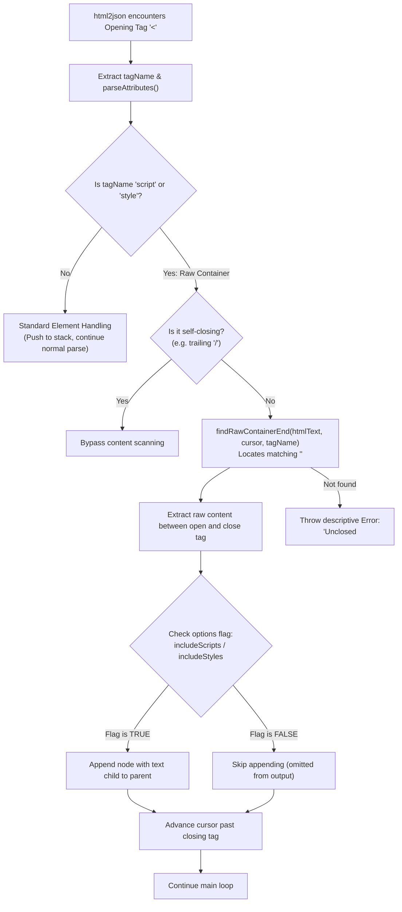

# Implementation Plan: Raw Text Containers (`<script>` and `<style>`)

## Goal Description
Enhance `html2json.js` and `index.html` to properly support **Raw Text Containers** (`<script>` and `<style>` elements) per HTML specifications:
1. Treat inline scripts and styles as standard element nodes with their raw body captured inside a text child node.
2. Accurately preserve element attributes (e.g., `defer`, `async`, `src`, `type`, `media`).
3. Add configurable filtering flags (`includeScripts` and `includeStyles`) both in the API and as UI toggles in `index.html`.
4. Guarantee that complex JavaScript (e.g., `for (let i = 0; i < len; i++)`, `const tag = "<div>"`, regexes) and CSS selectors (`div > p`, `span:not([hidden])`) never corrupt the AST or crash the parser.

---

## Architectural Rationale: Why Raw Text Containers Are Critical

In HTML5 (§12.2.5.1 and §12.2.5.5), `<script>` and `<style>` are defined as **RAWTEXT / Script Data Elements**.
Inside these elements, **standard HTML markup parsing is suspended**:

```html
<script defer src="main.js"></script>
<script>
  // In normal HTML, '<' means start of a tag.
  // In JavaScript, '<' is a comparison operator:
  for (let i = 0; i < list.length; i++) {
    if (a < b && c > d) {
      console.log("<div>test</div>");
    }
  }
</script>
<style>
  /* In CSS, '>' is a child selector: */
  nav > ul > li { color: red; }
</style>
```

Without dedicated raw container handling:
- The parser sees `i < list.length` and tries to parse `< list.length` as a tag name.
- The parser sees `"<div>test</div>"` inside a JS string and attempts to create AST child elements inside the script!
- The parser sees `nav > ul` and thinks `>` is prematurely closing a tag.

---

## The "Hard Parts" in Implementation

| Challenge | Why it's Difficult | Our Solution |
| :--- | :--- | :--- |
| **Case-Insensitive Closing Tag** | HTML allows `</script>`, `</SCRIPT>`, `</Script>`, `</style>`, `</STYLE>`. | Use case-insensitive matching for the closing tag sequence. |
| **Whitespace in Closing Tag** | HTML allows `</script   >` or `</style\n >`. | Allow whitespace between the tag name and the closing `>`. |
| **Prefix Clashes** | `</scripture>` or `</stylesheet>` must **not** prematurely close `<script>` or `<style>`. | Verify that the character following the tag name in the closing tag is either whitespace or `>`. |
| **Skipping vs. Including (Filtering Flags)** | When `includeScripts = false`, we want clean JSON without heavy JS code, but we **must still safely consume and skip** the script text from the cursor. | Parse the raw container boundary in all cases; only suppress attaching the node to `currentParent.children` when the respective flag is disabled. |
| **Attributes Preservation** | External scripts (e.g. `<script src="bundle.js" defer async></script>`) have no body, but require boolean flags. | Attributes are parsed before raw content extraction using our existing `parseAttributes()`, seamlessly capturing `defer: true`, `async: true`, `src: "..."`. |
| **Unclosed Containers** | If input cuts off before `</script>`, avoid infinite loops or silent bugs. | Detect end-of-string and report a structured, descriptive syntax error. |

---

## Output JSON Schema Representation

### 1. External Script with Attributes
Input: `<script src="app.js" defer async></script>`
Output:
```json
{
  "type": "element",
  "tag": "script",
  "attributes": {
    "src": "app.js",
    "defer": true,
    "async": true
  },
  "children": []
}
```

### 2. Inline Script with Operators & Code
Input: `<script>if (x < 10 && y > 20) { doSomething(); }</script>`
Output:
```json
{
  "type": "element",
  "tag": "script",
  "attributes": {},
  "children": [
    {
      "type": "text",
      "content": "if (x < 10 && y > 20) { doSomething(); }"
    }
  ]
}
```

### 3. Inline Style Sheet
Input: `<style>body > div { margin: 0; }</style>`
Output:
```json
{
  "type": "element",
  "tag": "style",
  "attributes": {},
  "children": [
    {
      "type": "text",
      "content": "body > div { margin: 0; }"
    }
  ]
}
```

---

## Proposed Architecture



---

## Detailed Step-by-Step Implementation

### 1. Helper Function: `findRawContainerEnd(htmlText, fromIndex, tagName)`
Finds the closing `</tagName>` without using regex:
```javascript
/**
 * Finds the position and closing index of a raw text container closing tag (</script> or </style>).
 * Case-insensitive, supports whitespace inside the closing tag (e.g. '</script  >').
 * @param {string} htmlText
 * @param {number} fromIndex - Index right after the opening tag '>'
 * @param {string} tagName - 'script' or 'style'
 * @returns {{ contentEnd: number, nextCursor: number } | null}
 */
function findRawContainerEnd(htmlText, fromIndex, tagName) {
  const targetTag = tagName.toLowerCase();
  let searchPos = fromIndex;

  while (searchPos < htmlText.length) {
    const closeStart = htmlText.indexOf(CLOSING_TAG_PREFIX, searchPos);
    if (closeStart === -1) return null;

    let i = closeStart + CLOSING_TAG_PREFIX.length;
    // Skip any whitespace inside closing tag (e.g. '</ script>')
    while (i < htmlText.length && htmlText[i] <= " ") i++;

    // Check if tag name matches case-insensitively
    const nameStart = i;
    while (
      i < htmlText.length &&
      htmlText[i] > " " &&
      htmlText[i] !== TAG_CLOSE &&
      htmlText[i] !== TAG_SLASH
    ) {
      i++;
    }
    const foundTagName = htmlText.substring(nameStart, i).toLowerCase();

    if (foundTagName === targetTag) {
      // Find the closing '>'
      const closeEnd = htmlText.indexOf(TAG_CLOSE, i);
      if (closeEnd !== -1) {
        return {
          contentEnd: closeStart,
          nextCursor: closeEnd + TAG_CLOSE.length,
        };
      }
    }

    searchPos = closeStart + CLOSING_TAG_PREFIX.length;
  }

  return null;
}
```

### 2. Main Parser Function Signature & Option Handling
Update `html2json` signature:
```javascript
function html2json(htmlText, options = {}) {
  const {
    includeScripts = true,
    includeStyles = true,
  } = options;
  // ...
```
When `tagName.toLowerCase() === "script"`:
- Extract raw content.
- If `includeScripts === true`, attach the node to `currentParent.children`.
- If `includeScripts === false`, simply discard the node from output (while cursor is safely advanced past `</script>`).

Similarly for `tagName.toLowerCase() === "style"` with `includeStyles`.

### 3. UI Controls in `index.html`
Add two checkboxes next to the example selector:
```html
<div class="options">
  <label><input type="checkbox" id="includeScripts" checked /> Include &lt;script&gt;</label>
  <label><input type="checkbox" id="includeStyles" checked /> Include &lt;style&gt;</label>
</div>
```
Pass the options object from `convertHtml2JsonAndSet()`:
```javascript
const options = {
  includeScripts: document.getElementById("includeScripts").checked,
  includeStyles: document.getElementById("includeStyles").checked,
};
const jsonObj = html2json(htmlTextAreaValue, options);
```

### 4. New UI Test Example
Add **Example 6 (Raw Text Containers: Script & Style)** showcasing:
- Script with comparison operators (`<`, `>`), quotes, and `defer`/`async` attributes.
- CSS style block with child selectors (`>`) and attribute selectors (`[href^="https"]`).
- Toggle verification (unchecking the boxes and reconverting removes them cleanly from the output).

---

## Verification Plan

### Test Scenarios
1. **Script with Math & Operators:**
   `<script defer>if (a < b && c > d) { console.log("ok"); }</script>`
   - Verify `defer: true` in attributes.
   - Verify exact JS string preserved in `content`.
   - Verify no phantom `< b` or `> d` tags created.
2. **CSS with Selectors:**
   `<style>nav > ul > li:hover { background: #fff; }</style>`
   - Verify selector preserved as text.
3. **Filtering Flags:**
   - Uncheck `Include <script>` $\rightarrow$ JSON contains no `script` element, but subsequent HTML tags are parsed with 100% accuracy.
   - Uncheck `Include <style>` $\rightarrow$ JSON contains no `style` element.
4. **Case-Insensitive Closing:**
   `<SCRIPT>console.log(1);</Script>`
   - Handled cleanly.
5. **Unclosed Raw Container:**
   `<script>console.log("no close");`
   - Returns clear error: `"Unclosed <script> tag starting at index 0. Expected '</script>'."`
