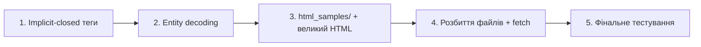

# План доопрацювання HTML2JSON

## 1. Implicit-closed теги

### Суть проблеми
HTML-специфікація дозволяє не закривати певні теги. Парсер зараз кидає помилку на **валідному** HTML:

```html
<ul>
  <li>Item 1
  <li>Item 2
</ul>
```
→ `Error: expected </li>, found </ul>`

### Підхід
Додати мапу «який тег автоматично закривається при появі іншого»:

```js
// Ключ — тег, який може бути auto-closed
// Значення — масив тегів, поява яких закриває ключ
const AUTO_CLOSE_MAP = {
  'p':        ['p','div','section','article','aside','nav','header','footer',
               'h1','h2','h3','h4','h5','h6','ul','ol','table','form',
               'blockquote','pre','hr','address','fieldset','figure','main','details','dl'],
  'li':       ['li'],
  'td':       ['td','th'],
  'th':       ['td','th'],
  'tr':       ['tr','thead','tbody','tfoot'],
  'dd':       ['dd','dt'],
  'dt':       ['dd','dt'],
  'thead':    ['tbody','tfoot'],
  'tbody':    ['tbody','tfoot'],
  'tfoot':    ['tbody'],
  'option':   ['option','optgroup'],
  'optgroup': ['optgroup'],
  'colgroup': ['colgroup'],
};
```

Логіка: **два місця** вставки в `html2json()`:

**A) Перед push нового тега** (секція 7 — opening tag):
```
Перед тим як пушити новий тег на стек,
перевіряємо: чи тег на вершині стеку автоматично закривається новим тегом?
Якщо так — pop зі стеку (закриваємо поточний неявно).
Повторюємо цю перевірку, бо може бути кілька рівнів.
```

**B) При обробці closing tag** (секція 6):
```
Якщо closing tag не збігається з вершиною стеку,
шукаємо його глибше в стеку.
Усі теги вище за нього, які є в AUTO_CLOSE_MAP — закриваємо автоматично.
Якщо знайшли match — pop до нього включно.
Якщо НЕ знайшли — ігноруємо closing tag (замість throw).
```

### Оцінка складності
~40–50 рядків нового коду + заміна 2 блоків кидання помилок. **Середня складність**, але дуже впливає на оцінку завдання.

---

## 2. Коментарі / `</script>` всередині `<script>`

### Висновок: це НЕ баг

Поточна поведінка **коректна за HTML-специфікацією**. Браузерний HTML-парсер також завершує `<script>` при першій зустрічі `</script>`, незалежно від JS-контексту (лапки, коментарі). Саме тому розробники пишуть `"<\/script>"` або `"</" + "script>"`, щоб уникнути цього.

> [!TIP]
> **Рекомендація:** нічого міняти не потрібно. Але можна додати коментар у коді біля `findRawContainerEnd()`, що пояснює чому це правильно — покаже обізнаність на code review.

---

## 3. Базове декодування HTML entities

### Оцінка: ~20 рядків коду, просто

```js
const NAMED_ENTITIES = {
  'amp': '&', 'lt': '<', 'gt': '>', 'quot': '"', 'apos': "'",
  'nbsp': '\u00A0', 'copy': '\u00A9', 'reg': '\u00AE',
  'mdash': '\u2014', 'ndash': '\u2013', 'hellip': '\u2026',
  'laquo': '\u00AB', 'raquo': '\u00BB',
};

function decodeHtmlEntities(text) {
  return text.replace(/&(#x?[0-9a-fA-F]+|[a-zA-Z]+);/g, (match, entity) => {
    if (entity.startsWith('#x') || entity.startsWith('#X')) {
      const code = parseInt(entity.slice(2), 16);
      return code ? String.fromCodePoint(code) : match;
    }
    if (entity.startsWith('#')) {
      const code = parseInt(entity.slice(1), 10);
      return code ? String.fromCodePoint(code) : match;
    }
    return NAMED_ENTITIES[entity] || match;
  });
}
```

Викликати в двох місцях:
- `processTextContent()` — перед поверненням результату
- `parseAttributes()` — на значення атрибутів

> [!NOTE]
> Повний список HTML entities — ~2000+ записів. Ми покриваємо лише найчастіші. Нерозпізнані залишаться як є (наприклад `&custom;`), що є безпечною поведінкою.

---

## 4. Папка `html_samples/` та великий HTML

### План
1. Створити папку `html_samples/`
2. Винести існуючі 6 прикладів у `.html` файли:
   - `01_standard_webpage.html` — Example 1
   - `02_simple_elements.html` — Example 2
   - `03_edge_cases.html` — Example 3
   - `04_malformed_html.html` — Example 4
   - `05_attributes_showcase.html` — Example 5
   - `06_raw_text_containers.html` — Example 6
3. Додати нові:
   - `07_large_document.html` — Великий реалістичний HTML (~200+ рядків: таблиці, форми, навігація, статті, бічна панель)
   - `08_inline_elements.html` — Inline елементи в тексті (`<p>Some <strong>bold</strong> and <em>italic</em> text</p>`)
   - `09_implicit_closing.html` — Тест для implicit closing tags (після реалізації п.1)

### Завантаження з `html_samples/` у дропдаун

**Є нюанс:** `fetch()` не працює з `file://` протоколом у більшості браузерів. Два варіанти:

**Варіант A — fetch + потрібен HTTP-сервер:**
```js
async function loadExample(filename) {
  const response = await fetch(`html_samples/${filename}`);
  document.getElementById("html").value = await response.text();
}
```
Потрібно відкривати через `npx serve`, `python -m http.server`, або Live Server у VS Code. Можна додати інструкцію в README.

**Варіант B — зберегти inline як fallback:**
Залишити приклади як JS-рядки, але генерувати їх із файлів при "збірці", або просто тримати дублікат. Простіше, але менш елегантно.

> [!IMPORTANT]
> **Рекомендую Варіант A** — він чистіший, демонструє роботу з файлами, і додати `npx serve` або `python3 -m http.server` інструкцію в README — це плюс. Проте, якщо потрібна сумісність з `file://`, можна зробити **гібрид**: `fetch` з fallback на inline-рядки.

---

## 5. Розбиття файлів

### Пропозиція структури

```
html2json.js    — тільки функція html2json() та її допоміжні функції
                  (parseAttributes, findNextOpenTagIndex, findTagCloseIndex,
                   findRawContainerEnd, processTextContent, decodeHtmlEntities,
                   константи, AUTO_CLOSE_MAP)

app.js          — UI-логіка: convertHtml2JsonAndSet(), loadExample(),
                  завантаження прикладів з html_samples/

index.html      — підключає обидва: <script src="html2json.js">
                                     <script src="app.js">
```

**Переваги:**
- `html2json.js` стає чистим, self-contained парсером — можна підключити в будь-який проєкт
- UI-логіка окремо — відповідає принципу розділення відповідальностей
- Відповідає вимозі README: *"`html2json.js` — This file should contain your implementation of the html2json function"*

---

## Порядок виконання



| Крок | Складність | Час |
|---|---|---|
| 1. Implicit-closed теги | Середня | ~40-50 рядків |
| 2. Entity decoding | Легка | ~20 рядків |
| 3. html_samples/ файли | Легка | створення файлів |
| 4. Розбиття + fetch | Легка | перенос коду |
| 5. Тестування всіх прикладів | — | перевірка |
